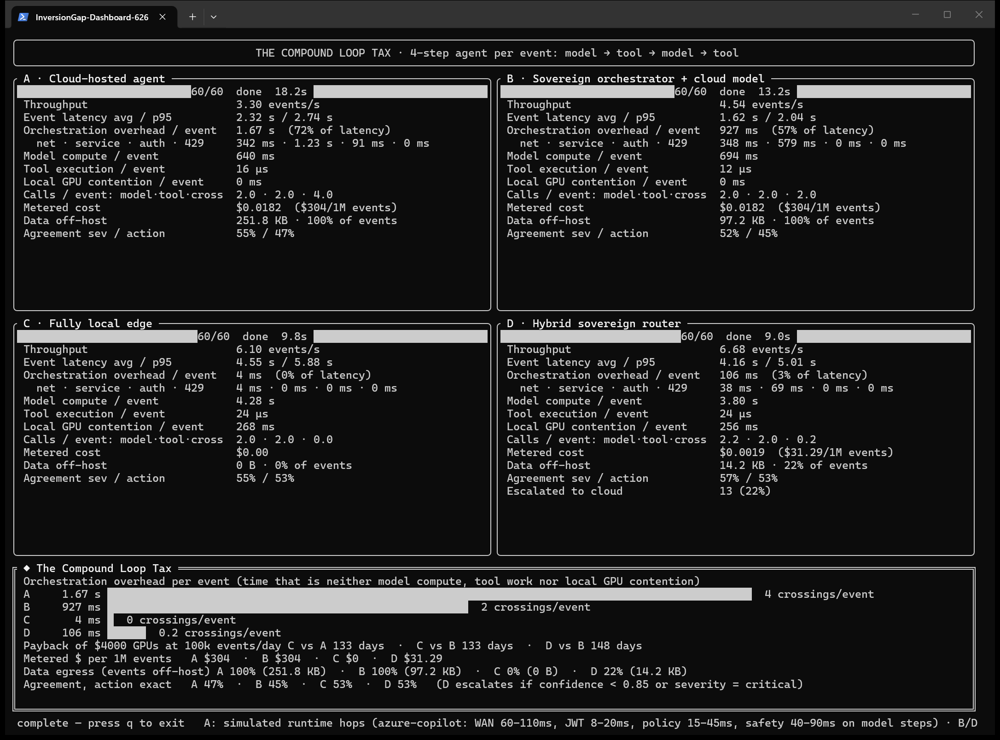

# InversionGap

**Measuring the Orchestration Tax: how much of a cloud-wrapped AI call is not the model.**

InversionGap is a Rust benchmark that runs the same security-event triage workload through two
architectures, side by side:

* a **cloud path**: an LLM reached through an API and a platform layer (auth, gateway, policy,
  safety, network), the way enterprise copilots and hosted agents are built; and
* an **edge path**: the same kind of model running on GPUs you own, called directly over loopback.

It measures where each millisecond, token and byte goes, and shows the results on a live terminal
dashboard. A second mode runs a 4-step **agent loop** (model → tool → model → tool), where the cost of
crossing the cloud boundary is paid on every step rather than once.



*The `agent` dashboard: real gpt-4.1-mini on Azure for arms A, B and D; phi4 14B on two local
RTX 5090s for arms C and D. The bottom panel is the Compound Loop Tax.*

> This README summarizes the findings and shows how to run everything yourself. Every number traces to a
> raw result file in [`results/`](results/README.md).

---

## What we found

All cloud numbers below come from real Azure OpenAI / Azure AI Foundry deployments (westus, November 2026).
All edge numbers come from Ollama on 2× RTX 5090. Every row maps to a JSON file in [`results/`](results/README.md).

### 1. Most of a hosted LLM call isn't the model

A single gpt-4.1-mini triage call took **≈ 590 ms**. Azure reports its own internal timing, which splits that
into:

| Part of the call | Time | Share |
|---|---|---|
| Model engine | ≈ 169 ms | **29%** |
| Azure service layer around the engine | ≈ 248 ms | 42% |
| Outside the service: network, TLS, client | ≈ 174 ms | 29% |

### 2. Concurrency can buy the throughput back, until quota or cost stops it

| Cloud client sends… | Edge (phi3, 2 GPUs) vs cloud throughput |
|---|---|
| 1 request at a time | edge **15.7×** faster |
| 4 at a time | 4.0× |
| 16 at a time | 1.2× |
| 32 at a time, high-quota global deployment | **1.0×, a tie** (7 runs) |

On a regional deployment with 200 requests/minute, a sustained 600-event run produced **2,081 HTTP 429
retries and 219 abandoned calls**. A local model with comparable quality (phi4 14B) matched gpt-4.1-mini
at 32 in flight: **25.4 vs 26.2 events/s**. Larger local models were several times slower: Llama 3.3 70B
reached 5.7/s, and qwen3.6 reached 6.0/s because Ollama cannot batch its architecture.

### 3. In an agent loop the tax compounds per crossing

Each event runs model → tool → model → tool, 100 events per arm:

| | **A** · cloud-hosted agent | **B** · local orchestrator, cloud model | **C** · fully local | **D** · hybrid router |
|---|---|---|---|---|
| Orchestration overhead / event | **1.68 s** | **967 ms** | **4 ms** | **128 ms** |
| Boundary crossings / event | 4 | 2 | 0 | 0.3 |
| $ per 1M events, gpt-4.1-mini | $301 | $304 | $0 | $44 |
| $ per 1M events, GPT-4o | $1,780 | $1,778 | $0 | $257 |
| Events whose data left the machine | 100% | 100% | 0% | 30% |

* **Payback.** $4,000 of GPUs at 100k events/day pays back in **≈ 133 days** against gpt-4.1-mini, and
  **≈ 22 days** against GPT-4o. Both figures are net of measured local energy.
* **Hybrid routing.** Arm D runs locally and escalates to the cloud when confidence is below 0.85 or the
  verdict is critical. That sent 30% of events to the cloud. Escalating on confidence alone sent **15%**,
  at $22 per 1M events, with the same agreement.

### What it does *not* show

* **Removing the tax does not make a slow local model fast.** At equal concurrency (8 in flight), an
  agent event took 3.5 s fully local (phi4) vs 1.5 s with local orchestration and the cloud model.
  The edge wins on throughput only when it batches many requests across both GPUs.
* **Arm A's runtime hops are simulated.** Its model calls are real Azure calls, but the hosted-agent
  runtime hops (WAN, JWT, policy, safety per step) come from a profile. B, C and D are fully measured.
* **Quality is a reference rubric, not ground truth.** Agreement with the rubric was similar across
  arms (45–48% exact action match in the agent loop), so none of the speed or cost results trade away
  quality on this task.
* **One machine, one region, one workload.** Different hardware, regions, quotas, models or tasks will move
  these numbers. The mock-gateway profiles are assumptions, and you can override them.

---

## How it works

```
                         ┌──────────────── cloud path ─────────────────┐
 events (deterministic)  │ OAuth/Entra → WAN → quota (429) → JWT →      │
 ───────────────────────►│ policy/routing → content safety → MODEL →   │──► verdict + timing breakdown
         same seed       │ serialize → WAN                              │
                         └──────────────────────────────────────────────┘
                         ┌──────────────── edge path ──────────────────┐
                         │ loopback → Ollama (one server per GPU) →     │──► verdict + timing breakdown
                         │ MODEL                                        │
                         └──────────────────────────────────────────────┘
```

Every call is split into **model compute** and **everything else**:

* **Real Azure.** Model time comes from the engine timing Azure returns (`usage.latency_checkpoint`).
  Service time comes from `x-envoy-upstream-service-time` / `openai-processing-ms`. Network is the
  client-measured remainder.
* **Mock gateway.** An in-process axum server applies each platform stage with configurable delays and
  reports each one in a `Server-Timing` header. The gateway's own HTTP and JSON work is real.
* **Ollama.** `prompt_eval_duration + eval_duration` is GPU compute. The rest of `total_duration` is
  local queueing (GPU contention). What's left of the client-measured time is loopback.

**Orchestration overhead** = network + auth + gateway/service + 429 back-off: time that is neither model
compute, nor tool work, nor waiting for your own GPU.

### Measured vs simulated

| | Real | Simulated |
|---|---|---|
| `--cloud openai` (Azure OpenAI, any OpenAI-compatible API) | everything | — |
| Mock gateway (default) | HTTP and JSON work (no TLS), auth flow, 429 back-off, the client | stage delays and WAN, from a profile; the synthetic model's verdicts and token counts |
| Edge (Ollama) | everything | — |
| `agent` arm A | model calls (when `--cloud openai`) | the hosted runtime's per-step hops |

---

## Run it yourself

Three levels, from "five minutes on a laptop" to reproducing every result.

### Level 1: no GPU, no cloud account

This exercises the mechanics with the mock gateway and its synthetic model. The latencies are the
profile's assumptions, not measurements. It's useful for seeing how the harness and dashboard work.

```powershell
cargo build --release
.\target\release\inversion-gap.exe agent --arms a,b --events 20
```

### Level 2: one local GPU

Install [Ollama](https://ollama.com) and pull a small model.

```powershell
ollama pull phi3
.\target\release\inversion-gap.exe check --model phi3            # endpoints, cold/warm call, GPU memory
.\target\release\inversion-gap.exe run --model phi3              # cloud (mock) vs edge, live dashboard
.\target\release\inversion-gap.exe agent --model phi3 --arms a,b,c,d
```

Press `q`, `Esc` or `Ctrl-C` to leave a dashboard; a summary table prints on exit. Add `--headless` for
plain text, or `--json out.json` to save the results.

A single Ollama server handles one request at a time unless `OLLAMA_NUM_PARALLEL` is set. To use several
GPUs, start one server per GPU (the next section shows how) and list them all in `--ollama-url`.

### Level 3: real Azure + multiple GPUs (reproduce the results)

**1. Start an edge pool.** This starts one `ollama serve` per GPU on ports 11435+, pinned with
`CUDA_VISIBLE_DEVICES`, with `OLLAMA_NUM_PARALLEL` set. Your main Ollama install is untouched.

```powershell
.\scripts\start-edge-pool.ps1 -NumParallel 16 -Model phi4:latest
#   models too big for one GPU (e.g. llama3.3:70b): add -Spread to split one server across all GPUs
.\scripts\stop-edge-pool.ps1    # when done; also kills orphaned llama-server runners
```

**2. Create the Azure deployments.** You need the `az` CLI and `az login`. Use `-DryRun` first to see the
commands. Everything is pay-per-token, so there is no idle cost.

```powershell
.\scripts\provision-azure.ps1 -ResourceGroup rg-inversiongap -Location westus
```

**3. Run against a real endpoint.** API keys are read from `az` into an environment variable and are
never written to disk.

```powershell
$acct = "<your aoai account>"
$env:INVERSION_CLOUD_API_KEY = az cognitiveservices account keys list -n $acct -g rg-inversiongap --query key1 -o tsv
$ep = "https://$acct.openai.azure.com/openai/deployments/gpt-41-mini-global/chat/completions?api-version=2024-10-21"

# single call, cloud vs edge
.\target\release\inversion-gap.exe run --model phi4 --ollama-url http://127.0.0.1:11435,http://127.0.0.1:11436 `
  --cloud openai --cloud-endpoint $ep --cloud-model gpt-41-mini-global --cloud-concurrency 32 --price-in 0.40 --price-out 1.60

# agent loop, arms A–D
.\target\release\inversion-gap.exe agent --model phi4 --ollama-url http://127.0.0.1:11435,http://127.0.0.1:11436 `
  --cloud openai --cloud-endpoint $ep --cloud-model gpt-41-mini-global --price-in 0.40 --price-out 1.60 --events 100
```

Use `--cloud-auth entra-cli` (on `run`) for a real Entra ID token instead of a key. Any other
OpenAI-compatible endpoint works with `--cloud-auth bearer`.

**4. Run the full matrices.**

```powershell
.\scripts\run-azure-suite.ps1 -Set phi3             # also -Set qwen | phi4 | edge; accounts from provision-azure.ps1
.\scripts\run-suite.ps1 -Set phi3                    # mock-gateway scenarios (v1)
.\scripts\measure-power.ps1 -Name phi4               # GPU board power over 1,000 edge-only events
.\scripts\capture-dashboard.ps1                      # real Windows Terminal screenshots
```

**5. Clean up:** `az group delete -n rg-inversiongap`

### Prerequisites

| | |
|---|---|
| **Rust** | Recent stable (developed on 1.99), edition 2024 |
| **Windows** | No Visual Studio needed. Use the GNU toolchain plus MinGW-w64 for `as`/`dlltool`: `rustup default stable-x86_64-pc-windows-gnu` and `winget install --id BrechtSanders.WinLibs.POSIX.MSVCRT --scope user`, then open a new terminal. VS Code with rust-analyzer works fine as the editor. |
| **Linux / macOS** | The Rust code is portable (Windows-only timer code is behind `cfg(windows)`). You need OpenSSL headers for `native-tls`, e.g. `libssl-dev`. The helper scripts are PowerShell; on Linux, start one `ollama serve` per GPU yourself, with `CUDA_VISIBLE_DEVICES` and `OLLAMA_HOST=127.0.0.1:1143x`. |
| **Ollama** | Levels 2–3. Tested with 0.40. |
| **Optional** | `nvidia-smi` (GPU info, power), `az` CLI (Azure). |

---

## Command reference

| Subcommand | What it does |
|---|---|
| `run` | Single-call head-to-head (cloud path vs edge path) with live dashboard |
| `agent` | 4-step agent loop across arms A–D, with payback and egress accounting |
| `check` | Verify Ollama endpoints and the model end to end |
| `gateway` | Run the mock cloud gateway on its own, e.g. on a remote VM for real WAN hops (`--wan-rtt-ms 0`, then `run --gateway-url http://<host>:8787`) |

`inversion-gap <subcommand> --help` documents every flag. The most useful ones:

| Flag | Meaning |
|---|---|
| `--cloud mock\|openai` | Mock gateway (default) or a real endpoint (`--cloud-endpoint`, `--cloud-model`, `INVERSION_CLOUD_API_KEY`) |
| `--profile azure-copilot\|azure-openai\|zero` | Mock gateway stage delays (table below); `zero` measures plumbing only |
| `--gateway-backend ollama` (`run`) | Mock gateway forwards to your local model: same model on both sides, so the gap is pure orchestration |
| `--cloud-concurrency`, `--edge-concurrency` | Requests in flight per side |
| `--price-in`, `--price-out` | USD per 1M tokens for the cloud meter |
| `--arms a,b,c,d` (`agent`) | Which arms to run |
| `--escalate-below 0.85`, `--no-escalate-critical` (`agent`) | Arm D's routing rule |
| `--hardware-usd 4000`, `--events-per-day 100000`, `--edge-energy-usd-per-m 0.6` (`agent`) | Payback inputs |
| `--headless`, `--json <file>`, `--snapshot-dir <dir>` | Plain text, JSON results, off-screen dashboard renders |
| `--events`, `--seed` | Workload size; the same seed gives every side the same events |

Mock gateway profiles (ms, drawn uniformly per request; defined in [`src/gateway.rs`](src/gateway.rs)):

| | WAN RTT | Token issue | JWT | Policy | Safety | Model | Meta-prompt | Quota |
|---|---|---|---|---|---|---|---|---|
| `azure-copilot` | 60–110 | 120–220 | 8–20 | 15–45 | 40–90 | 150–500 | +900 tok | 4 in flight |
| `azure-openai` | 25–60 | 80–150 | 3–8 | 5–15 | 20–50 | 150–400 | 0 | 8 |
| `zero` | 0 | 0 | 0 | 0 | 0 | 0 | 0 | 1024 |

These values are assumptions, informed by public guidance and the real Azure runs; override them with
`--wan-rtt-ms`, `--inference-ms` and `--quota`.

---

## The workload

* **Events** ([`src/events.rs`](src/events.rs)): deterministic synthetic security events (auth failures,
  port scans, privilege escalation, DNS exfiltration, suspicious PowerShell, plus benign and operational noise such as disk pressure and certificate expiry) from a seeded SplitMix64 generator, so every arm
  and every rerun sees identical input.
* **Triage** ([`src/triage.rs`](src/triage.rs)): the model returns `{severity, action, category, confidence}`
  as JSON. Quality is scored against a deterministic reference rubric (`heuristic_verdict`).
* **Agent tools** ([`src/tools.rs`](src/tools.rs)): a threat-intel/CMDB lookup and a ticket update. The
  same code runs in-process (arms B–D) and behind the gateway (arm A), so only the hop differs.

## Code layout

```
src/main.rs      CLI entry; run / agent / check / gateway orchestration
src/config.rs    command-line arguments (clap)
src/agent.rs     compound agent loop and arms A–D, hybrid escalation rule
src/tools.rs     agent tools: intel lookup, ticket update
src/cloud.rs     cloud client: auth (mock OAuth, api-key, bearer, Entra CLI), 429 back-off, timing attribution
src/gateway.rs   mock cloud gateway (axum): OAuth, JWT, quota, policy, safety, Server-Timing; Azure/Ollama forwarding
src/edge.rs      edge client: round-robin over per-GPU Ollama servers, compute/queue/loopback split
src/ollama.rs    thin Ollama HTTP client
src/wire.rs      OpenAI/Azure and Ollama wire types
src/events.rs    deterministic synthetic events
src/triage.rs    prompt, output schema, lenient parser, reference rubric
src/metrics.rs   per-arm accounting, gap and payback math
src/tui.rs       ratatui dashboards and off-screen renders
src/report.rs    plain-text and JSON reports
scripts/         edge pool, Azure provisioning, benchmark suites, power measurement, screenshots
results/         every run behind the findings above (see results/README.md)
```

## Things we learned building it

* **qwen3.6 (`qwen35moe`) cannot batch in Ollama.** It is a hybrid recurrent architecture, so Ollama
  forces one sequence at a time. That capped it at about 5–6 events/s on two GPUs. Standard-attention
  models (phi3, phi4, llama, gemma) batch normally.
* **JSON mode beats a full JSON schema** at high concurrency, because grammar-constrained sampling
  serializes batched slots. `--edge-format json` is the default.
* **The edge saturates at about 2 × `OLLAMA_NUM_PARALLEL`.** Beyond that, extra requests in flight
  only add latency.
* **Azure returns an undocumented engine timing** (`usage.latency_checkpoint`), which is what makes the
  29% model-share measurement possible.
* **Reasoning models need `reasoning_effort`.** gpt-5-mini returned empty answers (all reasoning tokens)
  until `--cloud-reasoning-effort minimal` was set.
* **The Windows timer resolution is 15.6 ms**, which quantizes every simulated delay. The binary calls
  `timeBeginPeriod(1)` and skips zero-length sleeps; without that, the cloud side would be overstated.
* **Spreading a 70B model needs `OLLAMA_SCHED_SPREAD=1` and no GPU pinning.** With pinning, Ollama
  silently put half the layers on the CPU. The first Llama 3.3 run was invalid because of this and was
  re-run (see `results/README.md`).

## License

[MIT](LICENSE). The results in this repository are covered by the same license.
